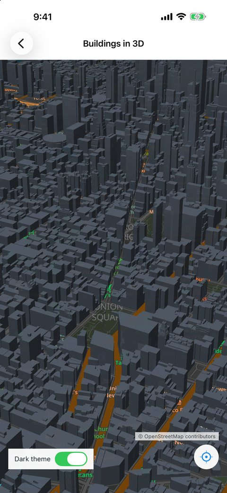
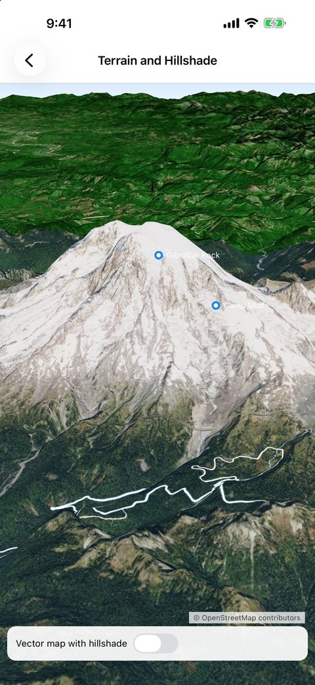
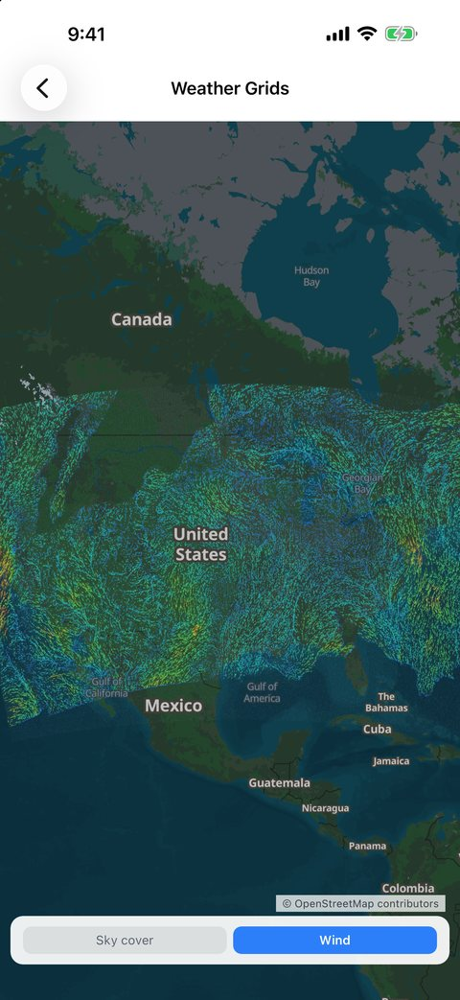
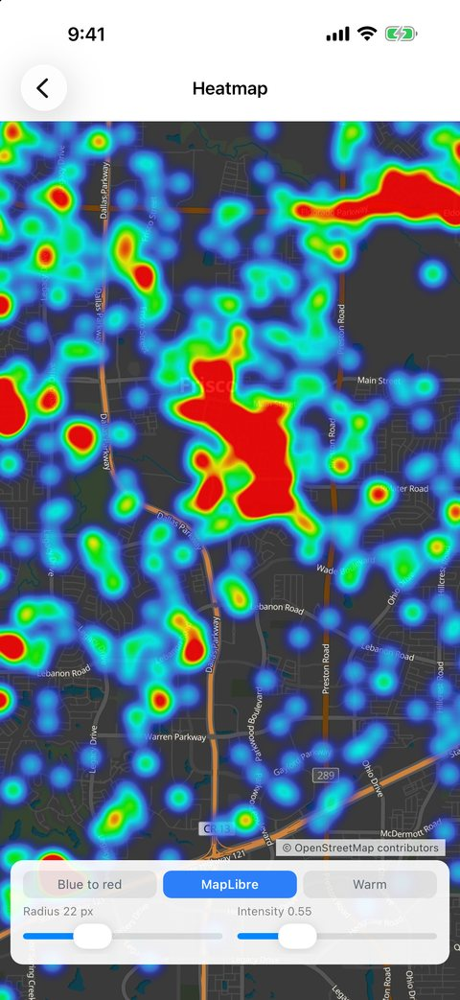
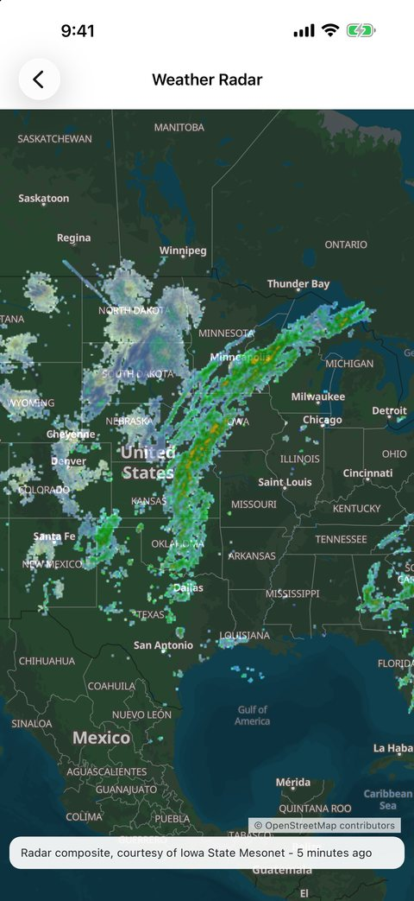
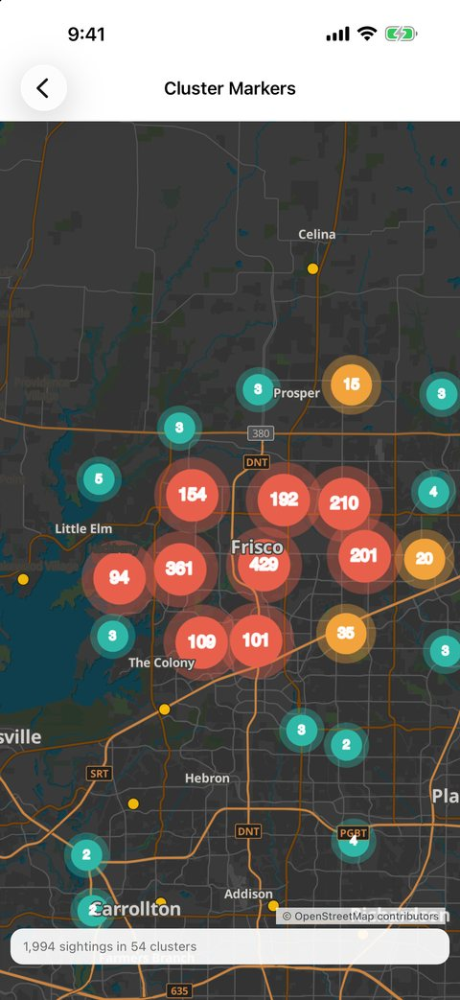
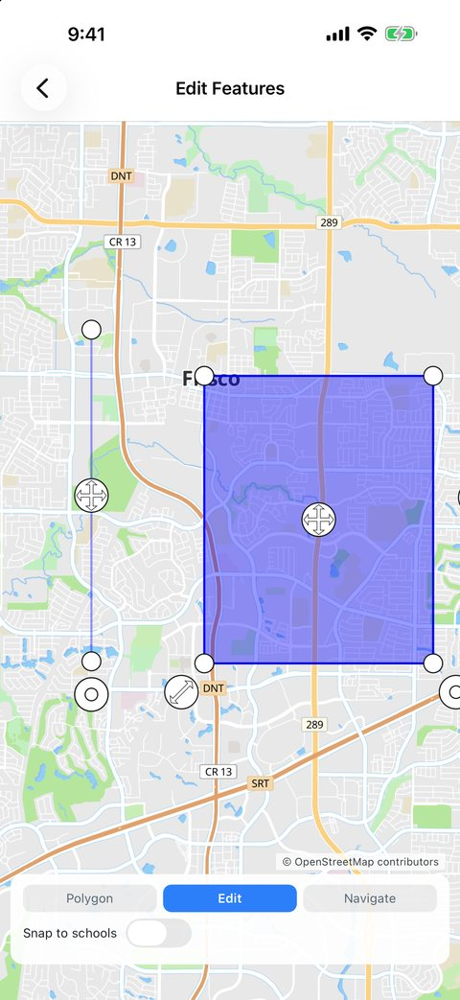
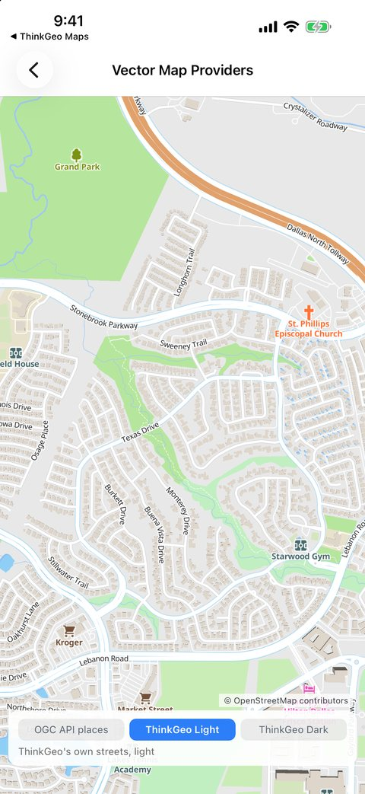

# The how-do-I gallery

One .NET MAUI app with a menu of 25 samples, each showing one thing a ThinkGeo map can do. Every
sample draws its map on the GPU, through `GpuBasemap`, with `ThinkGeo.UI.Maui` and `ThinkGeo.Gpu`
**15.1.0-beta030**. It runs on iOS, Android and Windows.

| Buildings in 3D | Terrain and Hillshade | Weather Grids | Heatmap |
|---|---|---|---|
|  |  |  |  |
| **Weather Radar** | **Cluster Markers** | **Edit Features** | **Vector Map Providers** |
|  |  |  |  |

## The samples

| Group | Sample | What it shows | Where to look |
|---|---|---|---|
| Map Navigation | [Buildings in 3D](Samples/MapNavigation/BuildingsIn3D.cs) | A city standing at its real height, with a light and a dark theme | `GpuBasemap`, `fill-extrusion` |
|  | [Terrain and Hillshade](Samples/MapNavigation/TerrainAndHillshade.cs) | Satellite imagery draped over terrain, and a hill-shaded vector map, at Mount Rainier | `MapStyle.SetTerrain`, `AddStyle` |
|  | [GPS Navigation](Samples/MapNavigation/GpsNavigation.cs) | A drive along a recorded GPS track, with the camera following the vehicle | `DynamicSource` |
|  | [Restrict Map Extent](Samples/MapNavigation/RestrictMapExtent.cs) | A map that cannot leave a box or go beyond two scales | `CurrentExtentChanging` |
|  | [Globe and Projections](Samples/MapNavigation/GlobeAndProjections.cs) | The world as a globe and in three projections, morphing between them | `DisplayProjection` |
| From a Service | [Vector Map Providers](Samples/FromAService/VectorMapProviders.cs) | The same map from several vector tile providers | `ThinkGeoVectorTileSource` |
|  | [Raster Map Providers](Samples/FromAService/RasterMapProviders.cs) | Aerial imagery, an XYZ tile server, a WMS and a WMTS | `RasterTileSource`, `WmsRasterTileSource`, `WmtsRasterTileSource` |
|  | [Live Flights](Samples/FromAService/LiveFlights.cs) | Every aircraft in the air right now, moving | `DynamicSource` |
|  | [Weather Radar](Samples/FromAService/WeatherRadar.cs) | The last half hour of weather radar, looping | `GeoImageRasterTileSource` |
| Your Data | [Vector File Formats](Samples/YourData/VectorFileFormats.cs) | Shapefile, GeoJSON, GPX, MapInfo TAB, TinyGeo and spatial SQLite | `FeatureSource` |
|  | [Offline Tiles](Samples/YourData/OfflineTiles.cs) | A map with no network: MBTiles and PMTiles archives on the device | `MbTilesVectorTileSource` |
| Styling | [Render Points, Lines and Polygons](Samples/Styling/RenderPointsLinesAndPolygons.cs) | Fills, lines, circles and labels, each with its own style | `MapStyle` |
|  | [Heatmap](Samples/Styling/Heatmap.cs) | A heatmap whose ramp, radius and intensity change as it runs | `MapStyle.SetHeatmapPaint` |
|  | [Isolines](Samples/Styling/Isolines.cs) | Contours drawn from scattered measurements | `MapStyle.AddIsolines` |
|  | [Weather Grids](Samples/Styling/WeatherGrids.cs) | Forecast sky cover as an animation and wind as moving particles | `MapStyle.AddGridFill`, `MapStyle.AddParticleFlow` |
| Markers and Popups | [Markers](Samples/MarkersAndPopups/Markers.cs) | Pins on the map: add them, remove them, animate them | `SimpleMarkerOverlay` |
|  | [Popups](Samples/MarkersAndPopups/Popups.cs) | A popup that stays on its point as the map moves and tilts | `PopupOverlay` |
|  | [Cluster Markers](Samples/MarkersAndPopups/ClusterMarkers.cs) | Thousands of points clustered into discs that open on a tap | `SimpleMarkerOverlay` |
| Map Tools and Adornments | [Scale Line and Scale Bar](Samples/MapToolsAndAdornments/ScaleLineAndScaleBar.cs) | The scale line and the scale bar, imperial or metric | `ScaleLineAdornmentLayer` |
|  | [Graticule Lines and Legend](Samples/MapToolsAndAdornments/GraticuleLinesAndLegend.cs) | A degree grid and a legend | `GraticuleAdornmentLayer`, `LegendAdornmentLayer` |
|  | [Export the Map to PDF](Samples/MapToolsAndAdornments/ExportTheMapToPdf.cs) | The map on screen written out as a vector PDF | `PdfGeoCanvas`, `PrinterLayoutDocument`, `MvtTilesAsyncLayer` |
| Shapes and Editing | [Measure Distance and Area](Samples/ShapesAndEditing/MeasureDistanceAndArea.cs) | The length of a line or the area of a polygon drawn with a finger | `TrackInteractiveOverlay`, `GetLength`, `GetArea` |
|  | [Edit Features](Samples/ShapesAndEditing/EditFeatures.cs) | Drawing shapes by hand, then dragging, resizing, rotating and reshaping them | `TrackOverlay`, `EditOverlay` |
|  | [Shape Operations](Samples/ShapesAndEditing/ShapeOperations.cs) | Buffer, simplify, rotate, scale, union, difference and the rest | `AreaBaseShape` |
|  | [Find Features by Spatial Relation](Samples/ShapesAndEditing/FindFeaturesBySpatialRelation.cs) | Tap the map to find what contains the point or lies near it | `QueryTools.GetFeaturesContaining` |

## How the source is laid out

| | |
|---|---|
| [`Samples`](Samples) | The samples. Each one is a single C# file, in a folder named after its group and with a name taken from its title: *Map Navigation > Buildings in 3D* is `Samples/MapNavigation/BuildingsIn3D.cs`. A sample has no XAML, no view model and no third-party NuGet packages, so the file is the whole of it. |
| [`Shell`](Shell) | The menu, the search and the page that hosts a sample. The menu is the list in [`Shell/SampleCatalog.cs`](Shell/SampleCatalog.cs). |
| [`Data`](Data) | The sample data, packaged into the app. |
| [`Tools`](Tools) | Scripts that open a sample by name on a simulator or an emulator and take a screenshot of it. |

## Building it

Open `HowDoISample.sln` in Visual Studio or Rider, pick a device and run. From a command line, in
this folder:

```sh
dotnet build HowDoISample.csproj -f net10.0-ios
dotnet build HowDoISample.csproj -f net10.0-android36.0
dotnet build HowDoISample.csproj -f net10.0-windows10.0.19041.0
```

- It needs .NET 10 with the MAUI workload. The minimums are iOS 15, Android 5.0 (API 21) and
  Windows 10 version 1809.
- The project builds against the published NuGet packages, so a clone of this repository is all it
  needs.
- The Windows head is part of the project only on a Windows machine. It is unpackaged, so it runs
  from the build output or with F5.

The samples carry a ThinkGeo Cloud key for evaluation. Sign up at
[https://cloud.thinkgeo.com](https://cloud.thinkgeo.com) for a key of your own.

New to ThinkGeo on MAUI? The [quick start](../quick-start-guide/QuickStartGuide_Maui_VS) puts a
first map on a page in seven steps.
