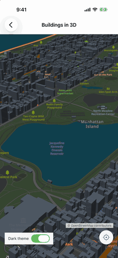
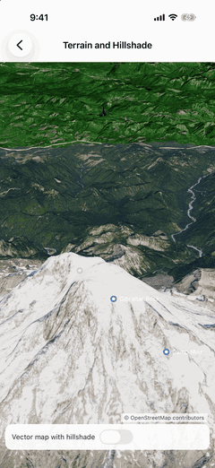
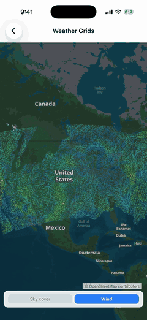
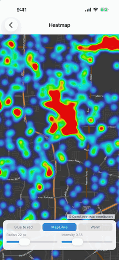

# ThinkGeo Mobile Maps

Samples for ThinkGeo's map controls on mobile. `ThinkGeo.UI.Maui` puts a ThinkGeo map in a
.NET MAUI app; the samples here show what that map can do and how little code each thing takes.

## The map is drawn on the GPU, from 15.1

From version **15.1.0-beta024**, `ThinkGeo.UI.Maui` draws its map on the GPU. The map is described
by one `MapStyle` and handed to the map view as a `GpuBasemap`:

```csharp
// MauiProgram.cs
builder
    .UseMauiApp<App>()
    .UseThinkGeoGpu();

// the page that holds the map
var style = new MapStyle(ThinkGeoVectorStyles.Light,
    new ThinkGeoVectorTileSource("your ThinkGeo Cloud API key"));

MapView.MapUnit = GeographyUnit.Meter;
MapView.Basemap = new GpuBasemap(style);
await MapView.RefreshAsync();
```

A map drawn this way can be tilted and rotated, and it is what 3D buildings, terrain, the globe,
heatmaps, isolines and animated weather grids are built on - each of them is a sample in the
gallery below. Markers, popups, adornments and the drawing and editing overlays are drawn above the
GPU basemap, as they were above the earlier one.

| | |
|---|---|
| Packages | `ThinkGeo.UI.Maui` and `ThinkGeo.Gpu`, on [nuget.org](https://www.nuget.org/packages/ThinkGeo.UI.Maui). 15.1 is a prerelease, so include prerelease versions when looking for it. Everything in this repository is built against **15.1.0-beta030**. |
| Platforms | The GPU map runs on iOS, Android and Windows. |
| Requires | .NET 10 with the MAUI workload. The samples set iOS 15, Android 5.0 (API 21) and Windows 10 version 1809 as their minimums. |

The latest stable release, 15.0.1, draws its map with the earlier renderer, in which a map is a
stack of overlays, and it has no `GpuBasemap`. The samples written for it are kept at the tag
[`v15.0.1`](https://gitlab.com/thinkgeo/public/thinkgeo-mobile-maps/-/tree/v15.0.1).

## What is here

| Folder | |
|---|---|
| [`quick-start-guide`](quick-start-guide/QuickStartGuide_Maui_VS) | The place to start: a guide, with its finished project, that puts a map and a shapefile on a page in seven steps. |
| [`HowDoISample`](HowDoISample) | The how-do-I gallery: 25 samples, one for each thing the map can do. |

## The how-do-I gallery

`HowDoISample/HowDoISample.sln` is one MAUI app with a menu of 25 samples. Every one of them draws
its map through `GpuBasemap`.

| Buildings in 3D | Terrain and Hillshade | Weather Grids | Heatmap |
|---|---|---|---|
|  |  |  |  |

More screenshots, and a link to each sample's source, are in the gallery's
[README](HowDoISample/README.md).

| Group | Samples |
|---|---|
| Map Navigation | Buildings in 3D, Terrain and Hillshade, GPS Navigation, Restrict Map Extent, Globe and Projections |
| From a Service | Vector Map Providers, Raster Map Providers, Live Flights, Weather Radar |
| Your Data | Vector File Formats, Offline Tiles |
| Styling | Render Points, Lines and Polygons, Heatmap, Isolines, Weather Grids |
| Markers and Popups | Markers, Popups, Cluster Markers |
| Map Tools and Adornments | Scale Line and Scale Bar, Graticule Lines and Legend, Export the Map to PDF |
| Shapes and Editing | Measure Distance and Area, Edit Features, Shape Operations, Find Features by Spatial Relation |

The source is laid out the way the menu is. Each sample is one C# file, in a folder named after its
group and with a name taken from its title: *Map Navigation > Buildings in 3D* is
`HowDoISample/Samples/MapNavigation/BuildingsIn3D.cs`. A sample has no XAML, no view model and no
third-party NuGet packages, so the file is the whole of it. The menu itself is the list in
`HowDoISample/Shell/SampleCatalog.cs`.

### Building it

Open `HowDoISample/HowDoISample.sln` in Visual Studio or Rider, pick a device and run. From a
command line:

```sh
dotnet build HowDoISample/HowDoISample.csproj -f net10.0-ios
dotnet build HowDoISample/HowDoISample.csproj -f net10.0-android36.0
dotnet build HowDoISample/HowDoISample.csproj -f net10.0-windows10.0.19041.0
```

- The project builds against the published NuGet packages, so a clone of this repository is all it
  needs. The sample data is in `HowDoISample/Data` and is packaged into the app.
- The Windows head is part of the project only on a Windows machine. It is unpackaged, so it runs
  from the build output or with F5.
- [`HowDoISample/Tools`](HowDoISample/Tools) has the scripts that open a sample by name on a
  simulator or an emulator and take a screenshot of it.

The samples carry a ThinkGeo Cloud key for evaluation. Sign up at
[https://cloud.thinkgeo.com](https://cloud.thinkgeo.com) for a key of your own.

## Native iOS and Android

`ThinkGeo.UI.iOS` and `ThinkGeo.UI.Android`, the map controls for apps that do not use MAUI, are
maintained and released alongside `ThinkGeo.UI.Maui`. Their samples are not in this branch; the
how-do-I sample for native iOS is kept with the 15.0.1 samples:
[ThinkGeo.UI.iOS how-do-I sample](https://gitlab.com/thinkgeo/public/thinkgeo-mobile-maps/-/tree/v15.0.1/Legacy/ThinkGeo.UI.iOS).

## More

- Documentation: [https://docs.thinkgeo.com](https://docs.thinkgeo.com). The mobile
  [quick start](https://docs.thinkgeo.com/products/mobile-maps/quickstart/) there was written for
  15.0, so its code builds a map from overlays; the code in this repository is the reference
  for 15.1.
- Questions: [https://community.thinkgeo.com](https://community.thinkgeo.com)
