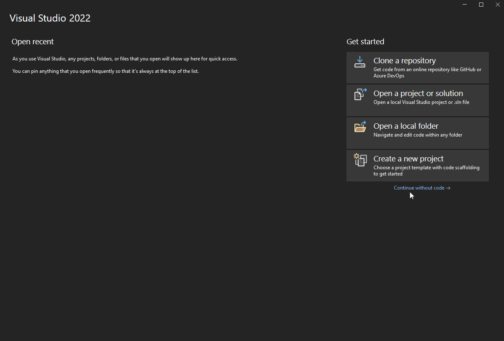
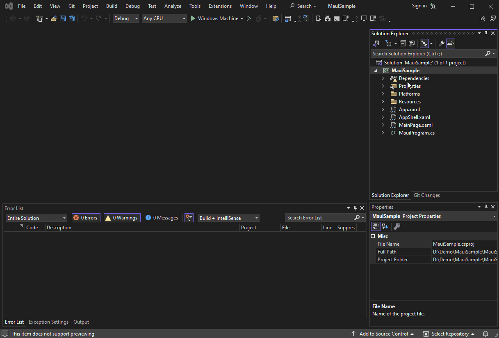
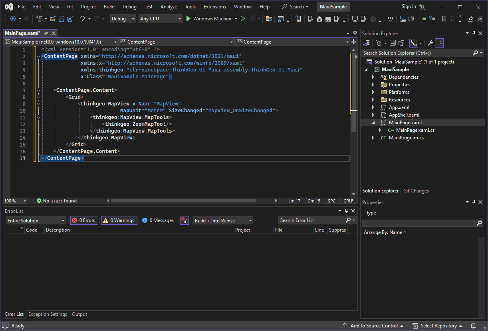

This guide uses Visual Studio with the .NET MAUI workload, but you can follow similar steps in other IDEs, such as JetBrains Rider. The project in this guide targets .NET 10 and ThinkGeo 15.

# Mobile Maps Quick Start: Display a Simple Map using .NET MAUI

In this section, we'll show you how to create a visually appealing map with ThinkGeo Cloud Maps as the background. We highly recommend that you also take a look at the [How Do I Sample](https://gitlab.com/thinkgeo/public/thinkgeo-mobile-maps/-/tree/master/HowDoISample?ref_type=heads), which has over 90 examples covering virtually everything you can do with the control.

### Step 1: Create a MAUI Project

Create a C# .NET MAUI App project with .NET 10.0. For the best experience and latest MAUI support, ensure your Visual Studio is updated to the most recent version.



### Step 2: Add the ThinkGeo MAUI NuGet Package

Install the **ThinkGeo.UI.Maui** NuGet package through NuGet package manager.

You can switch between the Beta Branch and Release Branch by checking/unchecking the "Include prerelease" checkbox. The Beta Branch contains the latest features/bug fixes, while the Release Branch is more stable and better tested. Check out [this guide](https://docs.thinkgeo.com/products/misc/nuget-package-guide/) for more details.



> **_NOTE:_** On Android, .NET 10's Mono runtime can crash a Release build at random (a native SIGSEGV in `libmonosgen`) when the app allocates heavily, which drawing a large data set does. Turn off its concurrent garbage collector in your `.csproj`. The cost is a longer pause during a full garbage collection; iOS, Mac Catalyst and Windows are not affected.

```xml
<PropertyGroup>
  <!-- Mono's concurrent GC can crash Android Release builds under heavy allocation: https://github.com/dotnet/runtime/issues/123537 -->
  <AndroidEnableSGenConcurrent>false</AndroidEnableSGenConcurrent>
</PropertyGroup>
```

### Step 3: Add the Map Control to `MainPage.xaml`

Add the ThinkGeo.UI.Maui namespace to `MainPage.xaml`

```xml
xmlns:thinkgeo="clr-namespace:ThinkGeo.UI.Maui;assembly=ThinkGeo.UI.Maui"
```

Add the map control within the `Grid` element in the `MainPage.xaml` file.

```xml
<thinkgeo:MapView x:Name="MapView"
    SizeChanged="MapView_OnSizeChanged">
</thinkgeo:MapView>
```



### Step 4: Add the ThinkGeo Cloud Background Map

Import the namespaces at the top of the `MainPage.xaml.cs` file.

```csharp
using ThinkGeo.Core;
using ThinkGeo.UI.Maui;
```

Add the following code to the `MapView_OnSizeChanged` event. Using the `_initialized` flag, this code runs once, when the map is fully loaded and ready to use. (The key passed to ThinkGeoVectorTileOverlay is a ThinkGeo Cloud key for the background map, for testing only; it is not your ThinkGeo license key. You can apply for your own Cloud key from [ThinkGeo Cloud](https://cloud.thinkgeo.com/clients.html))

We have set up a tile cache for the base overlay to improve performance. **FileSystem.Current.CacheDirectory** returns the app's cache directory on every platform.

```csharp
private bool _initialized;

private async void MapView_OnSizeChanged(object sender, EventArgs e)
{
    if (_initialized)
        return;
    _initialized = true;

    // Set the map's unit of measurement to meters(Spherical Mercator)
    MapView.MapUnit = GeographyUnit.Meter;

    // Add ThinkGeo Cloud Maps as the background 
    var backgroundOverlay = new ThinkGeoVectorTileOverlay("SGjwpxF60knqZi3R0A9RRE3GqiuRA1LsnxHMot7rJ58~")
    {
        TileCache = new FileRasterTileCache(FileSystem.Current.CacheDirectory, "ThinkGeoVectorTileLight_RasterCache")
    };
    MapView.Overlays.Add(backgroundOverlay);

    // set up the map rotation and map tools
    MapView.IsRotationEnabled = true;
    MapView.MapTools.Add(new ZoomMapTool());

    // set up the map extent and refresh
    MapView.CenterPoint = new PointShape(450061, 1074668);
    MapView.MapScale = 74000000;

    await MapView.RefreshAsync();
}
```

### Step 5: Run the Sample

Press F5 to build and run the app. You don't need to register or install anything first: ThinkGeo 15 checks its license when your project **builds**, not when it runs, so the Android emulator, the iOS simulator and your devices need nothing.

- **Without a license key**, the first build on your machine starts a free 30-day trial. The build succeeds with warning `TG0001`, which tells you how many days of the trial are left, and the map shows a *Not Licensed for Runtime* watermark. After 30 days the build stops with error `TG0002` until a key is in place.
- **With a license key**, the watermark goes away. Sign in at [helpdesk.thinkgeo.com](https://helpdesk.thinkgeo.com), download your Mobile key (`mobile.thinkgeokey`) and save it, with its name unchanged, on the machine that builds the app: in `%LOCALAPPDATA%\ThinkGeo\` on Windows, or in `~/.thinkgeo/` on macOS. Then build again. There is nothing to activate, and you don't need to restart Visual Studio.

The [License Guide for ThinkGeo 15](https://docs.thinkgeo.com/products/misc/license-guide-v15/) explains [how to get your key](https://docs.thinkgeo.com/products/misc/license-guide-v15/#get-your-license-key), [what each `TG` build message means](https://docs.thinkgeo.com/products/misc/license-guide-v15/#what-the-build-tells-you) and [how to build on a build server](https://docs.thinkgeo.com/products/misc/license-guide-v15/#build-servers-ci-and-containers). If you used ThinkGeo 14 before: Product Center and `.mapsuitelicense` files are no longer used, and `LicenseLoader.LoadLicense(...)` is no longer needed; see [What Changed from ThinkGeo 14](https://docs.thinkgeo.com/products/misc/license-guide-v15/#what-changed-from-thinkgeo-14).

Now you should see a working map with the ThinkGeo Cloud background map!

On Windows, you can double-click to zoom in, use the **Plus/Minus** buttons to adjust zoom, and perform track zoom by holding the Shift key while dragging the map. Additionally, rotate the map by holding the Alt key and dragging.


On both Android and iOS, you can double-click to zoom in, use the **Plus/Minus** buttons to zoom in or out, and rotate the map by holding a control key (such as Ctrl, Alt, or Option, depending on the operating system and emulator) and dragging within the Android Emulator, or by pinching on a real device.

<p align="center">
    
    
</p>

### Step 6: Add a Point Data Layer to the Map

Now that you have a basic setup, you can add custom data to the map. Depending on the data, this can be either complex or simple. Here, we are going to add a shapefile to the map. We will set the style for the shapefile, apply the style to a range of zoom levels, and project the shapefile from one projection (Decimal Degrees) to another (Spherical Mercator). This is basically what you need to do when displaying feature data on the map.

Download the [WorldCapitals](https://gitlab.com/thinkgeo/public/thinkgeo-mobile-maps/-/tree/master/quick-start-guide/QuickStartGuide_Maui_VS/MauiSample/AppData) shapefile data and use it in your project under a new folder called _**AppData**_. To use the data on every platform (Windows, Android and iOS), add the files as embedded resources and copy them to the app's data directory the first time the app runs. In Visual Studio, set the Build Action of each WorldCapitals file to **Embedded resource** in its file properties. Then add the `CopySampleData` method and call it from `OnStart` in `App.xaml.cs`:

```csharp
protected override async void OnStart()
{
    await CopySampleData(FileSystem.Current.AppDataDirectory);
}

private static async Task CopySampleData(string targetFolder)
{
    var assembly = Assembly.GetExecutingAssembly();
    List<string> dataFiles = new List<string>
    {
        @"WorldCapitals.dbf",
        @"WorldCapitals.ids",
        @"WorldCapitals.idx",
        @"WorldCapitals.shp",
        @"WorldCapitals.shx"
    };
    foreach (var dataFile in dataFiles)
    {
        var localPath = @"AppData/" + dataFile;
        var targetFilePath = Path.Combine(targetFolder, localPath);
        if (File.Exists(targetFilePath)) continue;

        var targetDir = Path.GetDirectoryName(targetFilePath);
        if (!Directory.Exists(targetDir))
            Directory.CreateDirectory(targetDir);

        await using (var targetStream = File.Create(targetFilePath))
        {
            var sourceStream = assembly.GetManifestResourceStream(@"{ProjectName}.AppData." + dataFile);
            await sourceStream.CopyToAsync(targetStream);
            sourceStream.Close();
        }
    }
}
```

Be sure to change the `{ProjectName}` placeholder in the above code to the name of your project. From there, we can add the shapefile to the map in the `MapView_OnSizeChanged` method in `MainPage.xaml.cs`. Insert the following code above the `RefreshAsync()` call to have it displayed during the first refresh:

```csharp
// Add a shapefile layer with point style.
var filePath = Path.Combine(FileSystem.Current.AppDataDirectory, "AppData", "WorldCapitals.shp");
var capitalLayer = new ShapeFileFeatureLayer(filePath);
var capitalStyle = new PointStyle()
{
    SymbolType = PointSymbolType.Circle,
    SymbolSize = 8,
    FillBrush = new GeoSolidBrush(GeoColors.White),
    OutlinePen = new GeoPen(GeoColors.Black, 2)
};
// Each layer has 20 preset zoomlevels. Here we set the capitalStyle for ZoomLevel01 and apply the style to the other preset zoomlevels.
capitalLayer.ZoomLevelSet.ZoomLevel01.DefaultPointStyle = capitalStyle;
capitalLayer.ZoomLevelSet.ZoomLevel01.ApplyUntilZoomLevel = ApplyUntilZoomLevel.Level20;

// The shapefile is in Decimal Degrees, while the base overlay is in Spherical Mercator.
// It's why the shapefile needs to be reprojected to match the coordinate system of the base overlay.
capitalLayer.FeatureSource.ProjectionConverter =
    new ProjectionConverter(Projection.GetDecimalDegreesProjString(), Projection.GetSphericalMercatorProjString());

// Add the layer to an overlay, add that overlay to the map.
var customDataOverlay = new LayerOverlay();
customDataOverlay.Layers.Add(capitalLayer);
MapView.Overlays.Add(customDataOverlay);
```

<p align="center">
    
    
</p>

## Summary

You now have a basic understanding of how to use the ThinkGeo UI MAUI controls and can begin adding functionality to your own applications. Let's review what we've learned about the object relationships and how the pieces of ThinkGeo UI MAUI work together:

1. A `MapView` is the fundamental control that contains all the other objects used to determine how the map is rendered.
2. A `MapView` has multiple `Overlays`, and each `Overlay` corresponds to a tier of images displayed on the map control.
3. A `LayerOverlay` has multiple layers, and each `Layer` corresponds to a single data source, such as a shapefile.
4. A `FeatureLayer` can have multiple `ZoomLevels`, which define the upper and lower ranges of when a layer should be shown or hidden, and the styles for how the layer is supposed to be displayed.
5. The `MapUnit` (feet, meters, decimal degrees, etc.) and the map extent (`CenterPoint`, `MapScale`) need to be correctly set for the map control.

Congratulations, you are now in an excellent position to review the [How Do I Sample](https://gitlab.com/thinkgeo/public/thinkgeo-mobile-maps/-/tree/master/HowDoISample?ref_type=heads) and explore other features.
