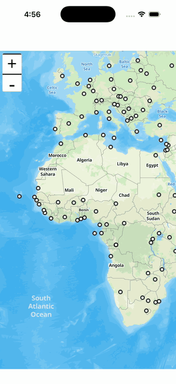

# Quick Start: a ThinkGeo map in a .NET MAUI app

`MauiSample` is the finished project of this guide: a .NET MAUI page with a ThinkGeo map on it,
ThinkGeo Cloud Maps as the base map and a shapefile of the world's capitals drawn over it. The map is
drawn on the GPU, which is how ThinkGeo 15.1 draws maps.

The project targets iOS, Android and, on a Windows machine, Windows.



## Step 1: Create a .NET MAUI project

Create a new **.NET MAUI App** in Visual Studio, or with `dotnet new maui`.

## Step 2: Add the NuGet packages

```xml
<PackageReference Include="ThinkGeo.UI.Maui" Version="15.1.0-beta034" />
<PackageReference Include="ThinkGeo.Gpu" Version="15.1.0-beta034" />
```

`ThinkGeo.UI.Maui` is the map control and `ThinkGeo.Gpu` is the engine that draws it. Both are
prereleases, so tick **Include prerelease** when looking for them in the NuGet package manager.

## Step 3: Register the GPU map

In `MauiProgram.cs`, add `UseThinkGeoGpu()` to the app builder. Without it the map has nothing to
draw on.

```csharp
builder
    .UseMauiApp<App>()
    .UseThinkGeoGpu()
```

## Step 4: Add the map to MainPage.xaml

```xml
<ContentPage xmlns="http://schemas.microsoft.com/dotnet/2021/maui"
             xmlns:x="http://schemas.microsoft.com/winfx/2009/xaml"
             xmlns:thinkgeo="clr-namespace:ThinkGeo.UI.Maui;assembly=ThinkGeo.UI.Maui"
             x:Class="MauiSample.MainPage">
    <ContentPage.Content>
        <Grid>
            <thinkgeo:MapView x:Name="MapView" SizeChanged="MapView_OnSizeChanged" />
        </Grid>
    </ContentPage.Content>
</ContentPage>
```

## Step 5: Add the base map

Everything the map draws is described by one `MapStyle`. The base map is a ThinkGeo style over
ThinkGeo Cloud's vector tiles; the tiles are kept on the device between runs.

```csharp
MapView.MapUnit = GeographyUnit.Meter;

var cloudTiles = new ThinkGeoVectorTileSource("your ThinkGeo Cloud API key")
{
    VectorTileCache = new FileTileCache(Path.Combine(FileSystem.Current.CacheDirectory, "ThinkGeoVectorTiles"))
};

var style = new MapStyle();
style.AddStyle(ThinkGeoVectorStyles.Light, cloudTiles);

MapView.Basemap = new GpuBasemap(style);

MapView.CenterPoint = new PointShape(450061, 1074668);
MapView.MapScale = 74000000;
await MapView.RefreshAsync();
```

The sample carries a ThinkGeo Cloud key for evaluation. Sign up at
[https://cloud.thinkgeo.com](https://cloud.thinkgeo.com) for a key of your own.

## Step 6: Add your own data

The capitals are a shapefile. A `FeatureSourceVectorTileSource` serves it to the map as a layer
named `capitals`, and a second style says how that layer is drawn.

```csharp
var capitalTiles = new FeatureSourceVectorTileSource();
capitalTiles.FeatureSources.Add("capitals", new ShapeFileFeatureSource(filePath)
{
    // The shapefile is in decimal degrees and the map is in Spherical Mercator.
    ProjectionConverter = new ProjectionConverter(4326, 3857)
});

style.AddStyle(CapitalStyle, capitalTiles);
style.Images.Add("capital", PointStyle.CreateSimpleCircleStyle(GeoColors.White, 8, GeoColors.Black, 2));
```

```json
{
  "layers": [
    { "type": "symbol",
      "source-layer": "capitals",
      "layout": { "icon-image": "capital", "icon-allow-overlap": true } }
  ]
}
```

The shapefile ships inside the app as embedded resources and `App.xaml.cs` copies it into the
app's data directory on first run, so the code above opens it by file path.

## Step 7: Run it

Pick an Android emulator, an iOS simulator or Windows, and run: the world's capitals, as white
circles, over the base map. Pinch to zoom, drag to pan and twist to rotate; the `+` and `-` buttons
in the corner are the `ZoomMapTool`. The capitals are drawn with the map, so they stay sharp and in
place at every zoom, as in the animation at the top of this page.

## More

The how-do-I gallery in [`HowDoISample`](../../HowDoISample) has a sample for each thing the map
can do. The online guide at
[https://docs.thinkgeo.com/products/mobile-maps/quickstart/](https://docs.thinkgeo.com/products/mobile-maps/quickstart/)
covers creating the project and licensing in more detail; it was written for ThinkGeo 15.0, whose
map was built from overlays, so its code differs from the code here.
